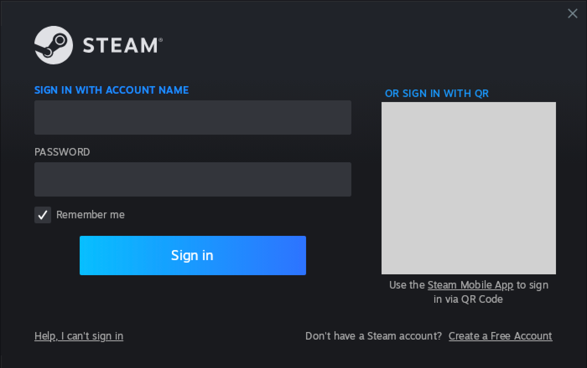

# Install guide

Getting **Cities: Skylines II** running on an Apple Silicon Mac, free — no CrossOver licence.
Mods included.

## The quick way

One line in Terminal does the whole install. It makes the Wine wrapper, puts Steam for Windows in it,
waits while you sign in and the game downloads, then applies the fixes and builds the game's app.

**You need:** an Apple Silicon Mac on macOS 26 or 27, a Steam account that owns Cities: Skylines II, and
about 105 GB of free disk space (the game with all its DLC is about 100 GB).

1. Open **Terminal** (in Applications → Utilities), paste this line and press Return:

   ```bash
   /bin/bash -c "$(curl --proto '=https' --tlsv1.2 -fsSL https://raw.githubusercontent.com/macgameport/1launcher/release/install.sh)" 1launcher-install 949230
   ```

   The number at its end is the game's Steam app ID: it tells the installer which game is meant.

   macOS 26.4 and later can stop a pasted command with "Possible malware, paste blocked"; it is reported
   to let you paste it anyway. What the line runs is the script at that address, which you can read in a
   browser first.
2. The window works through six steps and says what each one is doing. It can ask for two things on the
   way: to install Rosetta 2 (type `y`), and, in a box from Apple, to install Apple's Command Line Tools
   (press Install, then Agree). Leave the window open; the Mac is kept awake while it runs.
3. When Steam's sign-in window appears, sign in with the account that owns the game, with "Remember me"
   ticked. Steam may ask for a code from your email or the Steam app. A small box headed
   "Steam - Fatal Error" can appear once or twice before the sign-in window and close again: that is
   Steam updating itself, and nothing in it needs a click.

   
4. In Steam, click **Library**, then **Cities: Skylines II**, then **Install**. The download takes hours.
   When it finishes Steam shows a green Play button: do not press it, it does not work from inside Steam.

   
5. The installer sees the download finish, closes Steam, applies the fixes and builds the app. It ends
   with `Done.`
6. Play: **Cities Skylines II** in Applications, or **14unch3r**, the window that lists every game set up
   on this Mac. One setting is worth changing in the game: see [Play](#5-play) below.

Good to know:

- **One Steam at a time.** If Steam for Windows is open in another wrapper on this Mac (another game of
  this project, or its Steam app), the installer stops before it starts its own and says which one: quit
  it, then open the installer again. Two Steams on one account push each other out, and the one pushed out
  skips its cloud upload. The installer cannot see a Steam on another Mac, or the Steam of macOS: close
  those yourself.
- **Stopped part way?** Paste the line again. It carries on from the step it stopped at. Closing the
  window or pressing Control-C stops the installer only: Steam stays open. Pasting the line again on a
  finished install is also how to update: it fetches the current scripts and re-applies the fixes.
- **What it downloads, and from whom.** The Wine engine and the wrapper it lives in are
  [Porting Kit](https://www.portingkit.com/)'s, fetched from their own pages on GitHub and checked against
  fixed checksums; Steam's installer comes from Valve; Rosetta and the Command Line Tools, if missing, come
  from Apple. Nothing is re-hosted here. Wine and Valve's installer run as they come: macOS does not
  check programs fetched this way.
- **What it follows.** The line fetches this repository's `release` branch, which moves forward only after
  the tests have passed. A fix made after a game update reaches the installer once it is there.
- **To look before it touches anything**, give it `--check`. With the pasted form the words after the
  closing quote are a name and then the arguments:
  `... install.sh)" 1launcher-install 949230 release --check`
- **Asking for help?** Terminal's output can show your Mac's user name inside file paths. Look for it
  before pasting the output anywhere public.
- **Have a clone?** `bash cities-skylines-2/scripts/install.sh` is the same installer, from your checkout.

---

## By hand

The numbered steps below do the same by hand, with Porting Kit's app. They are also where each of the
installer's steps is explained.

**Time:** about 20 minutes of clicking, plus however long the game takes to download.
**You need:**

- An Apple Silicon Mac (M1 or newer) on **macOS 26 or 27**. Those are the releases this is tested on;
  older ones are not expected to work, and macOS 28 will not. Details: [Compatibility](../README.md#compatibility).
- **Rosetta 2.** If you are not sure it is installed, paste this into Terminal:
  `softwareupdate --install-rosetta --agree-to-license`
- The game already owned on Steam.
- Disk space for the game: about 100 GB with all its DLC (103 GB by Steam's count on the test Mac).
- Setup checks all of this for you and says so line by line. `OK` is fine. `CAUTION` means this Mac is
  outside what has been tested: setup explains why, asks you to press Return, and goes on. `MISSING` means
  something it cannot work without, with the command that fixes it.
- Step 4 uses **Terminal** (in Applications → Utilities). The first time you run a `git` command, macOS
  offers to install Apple's Command Line Tools: accept, wait for it to finish, and run the command again.

> Tested on an M3 Max running macOS 26 with game version 1.6.0f1, and on an M5 Max running macOS 27.0.1
> with 1.6.2f1 (2026-10-10); booted to the main menu on an M3 Max on macOS 27.2 (2026-11-07). Intel Macs
> are not supported. On macOS 27, check Rosetta is still installed
> after every update (`arch -x86_64 /bin/ls /`); the launcher also checks, and if Rosetta is gone it
> stops with the reinstall command (`softwareupdate --install-rosetta --agree-to-license`). A game
> update can move the patch offsets — see [After a game update](#after-a-game-update).

---

## 1. Install the Wine wrapper

The stack is ordinary Wine plus **DXMT**, which translates the game's Direct3D 11 calls to Metal.
The easiest way to get a Wine build with the pieces DXMT needs is
**[Porting Kit](https://www.portingkit.com/)** — free, and it ships the engine this project is
built on (`WS12Wine11.0_DXMT-v0.80`).

1. Download and install Porting Kit.
2. Create a new wrapper using the **Wine 11.0 + DXMT** engine.
3. Name it `CS2dxmt11` — the scripts look for `~/Applications/CS2dxmt11.app` by default. Any name
   works if you pass `CS2_WRAPPER=/path/to/Wrapper.app` later.

Porting Kit's UI changes between versions, so follow their current instructions for creating a
wrapper. What matters is the end state: **`~/Applications/CS2dxmt11.app` exists and contains
`Contents/SharedSupport/prefix`**.

> **Porting Kit 6.7.0:** creating the wrapper can fail with `ERROR: WS12WineWine11.0_1_DXMT-v0.80
> not found`. It downloads the engine correctly, then adds the `WS12Wine` prefix a second time when
> it looks for it. Copy the downloaded archive to the doubled name and try again (reported on
> macOS 27.0, [#15](https://github.com/macgameport/1launcher/issues/15); a Porting Kit
> bug, not this project's):
>
> ```bash
> cd ~/Library/Application\ Support/Wineskin/Engines/ && cp WS12Wine11.0_1_DXMT-v0.80.tar.7z WS12WineWine11.0_1_DXMT-v0.80.tar.7z
> ```

*If Porting Kit is doing something useful for you, donate to them — this project only exists
because they publish that engine.*

## 2. Install Steam inside the wrapper

Steam has to live **inside** the wrapper's Windows prefix, not your Mac's Steam.

1. Download the Windows Steam installer (`SteamSetup.exe`).
2. Run it inside the wrapper: Porting Kit's "Install software into wrapper", or this one line in
   Terminal:

   ```bash
   WINEPREFIX=~/Applications/CS2dxmt11.app/Contents/SharedSupport/prefix ~/Applications/CS2dxmt11.app/Contents/SharedSupport/wine/bin/wine64 ~/Downloads/SteamSetup.exe
   ```

3. Launch Steam inside the wrapper and **sign in**, letting the library finish loading. Tick "remember
   me" so later launches sign in on their own.

## 3. Install the game

In that same in-wrapper Steam, install **Cities: Skylines II** and let it download fully.

Don't press **Play** when it finishes — it won't work. Steam's Play button routes through the
Paradox Launcher, which exits before the game starts. The launcher this project installs runs the
game executable directly, which is the whole trick.

## 4. Run setup

```bash
git clone https://github.com/macgameport/1launcher.git
cd 1launcher/cities-skylines-2
bash scripts/setup.sh
```

Setup needs no network and installs nothing with `pip`: the two small Python libraries the patch scripts
use ship with them. Its last lines say how many of the ten patch scripts finished, and it ends with
`=== setup complete ===` only when all of them did and the app was built.

> **Mods did not download after an earlier setup?** Setups made between 2026-10-10 and 2026-11-09 applied
> only five of the ten patches without saying so
> ([#23](https://github.com/macgameport/1launcher/issues/23)). Update the checkout (`git pull`) and run
> `bash scripts/setup.sh` again.

That checks your prerequisites, installs the launcher into `~/cs2-patch/`, applies the binary
patches, and builds a double-clickable **Cities Skylines II.app** in `~/Applications` using the
game's own icon, and **14unch3r**, the window that lists every game set up on this Mac.

At the end it asks `Put a 14unch3r shortcut on the Desktop? [y/N]`. Pressing Return means no; type `y`
for one. It asks only when it is run in Terminal and no shortcut is there, and it never replaces anything
already on the Desktop by that name. `bash scripts/setup.sh --desktop` makes the shortcut without asking;
`--yes` does not.

Want to look before it touches anything? `bash scripts/setup.sh --check` runs the checks and stops.

## 5. Play

Double-click **~/Applications/Cities Skylines II.app**.

The first launch starts Steam inside the wrapper and waits about 15 seconds for Steam to confirm
your licence. A small window at the top right shows each step and closes as the game starts. When Steam
is already running, the wait is skipped.

**One setting to change, in-game:** Options → Graphics → **Display Mode → Fullscreen Window**.

Exclusive Fullscreen has a presentation bug on this stack: alt-tab away and the screen stops
updating, even though the game is still running fine underneath. It's
[reported upstream](https://github.com/3Shain/dxmt/issues/206); Fullscreen Window looks identical
and is immune. (If you ever do get stuck in exclusive mode, you're not dead — the screen redraws
one frame per alt-tab, so you can alt-tab your way to Options and switch modes.)

---

## 6. Recommended: build the wine 11.16 engine (kills the alt-tab freeze)

The base stack above runs on Porting Kit's wine 11.0 engine, which has one real defect: in
exclusive Fullscreen, switching away (Cmd-Tab, or just clicking another window/display)
permanently freezes the render ([dxmt#206](https://github.com/3Shain/dxmt/issues/206)). Wine
**11.16 fixed it upstream**, but no prebuilt clean-base 11.16 DXMT engine exists yet — so this
repo builds one, locally, from the official Wine source:

```bash
bash scripts/build-engine-1116.sh
```

⚠ **One trade-off, decided by measurement:** the 11.16 engine kills the alt-tab freeze and is
faster, but **Steam's visible storefront window is black on it** (the game, its login, licences
and Paradox Mods downloads are all unaffected — the daily flow runs Steam in tray mode). The
build script handles this for you: it preserves the wine 11.0 wrapper as `CS2dxmt11-pk110.app`
(an APFS clone — under a minute, ~no extra disk, the game install stripped from the clone) and
installs **S734M.app**, the Windows Steam, in `~/Applications` (until 2026-11-10 it was called **CS2 Steam
Store.app**). Play from **Cities Skylines II.app** or from **14unch3r**, which lists every game set up on this
Mac; buy DLC and browse from **S734M.app** — licences are account-level, so purchases cross
over immediately. The store wrapper has no game install, so its library always shows CS2 as
not installed; DLC with content downloads in the game's own Steam the next time it signs in
(measured 2026-11-01: a 437 MB set, finished within a minute, no game update needed). One
account holds one online Steam session, so opening the store while
playing steals the session from the game's Steam; measured harmless — the game keeps running,
and the next game launch takes the session back. Built the engine before this existed?
`bash scripts/make-steam-shortcut.sh` retrofits the wrapper + shortcut. Since 2026-10-11 the
build also applies upstream wine commit 6cfa941, which stops frameless Electron windows (the
Paradox launcher) getting a macOS title bar and clicks landing ~28 pt low; an engine built
before then picks it up by re-running the script (a full rebuild and reinstall). Cause and the full
list of attempted workarounds: [GOTCHAS.md](GOTCHAS.md) and
[dxmt#141](https://github.com/3Shain/dxmt/issues/141).


### The DXMT halves are different vintages, deliberately

The cross-process fix needs a patched `winemetal.so`, but nothing else on the DXMT side is rebuilt,
so the installed stack pairs two vintages:

| piece | where it comes from |
|---|---|
| `d3d11.dll`, `dxgi.dll`, `winemetal.dll` (PE) | **Porting Kit's build.** `d3d11.dll` carries the version string `v0.80-17-g79f6279`, a commit that is not in 3Shain/dxmt — a fork or a rewritten branch. Its `winemetal.so` embeds AIR metadata naming a Gcenx checkout of dxmt, per the build paths compiled into it |
| `winemetal.so` (unix) | **built here** from tag `v0.80` plus [`scripts/dxmt-remote-layer-fallback.patch`](scripts/dxmt-remote-layer-fallback.patch) |

The `.so` and the PE side are different DXMT vintages; they agree on the two unix calls this patch
touches, and the pairing has been exercised on every render cell since 2026-08-31. Neither the
installed `.so` nor Porting Kit's embeds a version string, so the `.so`'s vintage is provable only
by provenance: it `cmp`s identical to the build artifact (27,924,120 B), the scratch tree
`git describe`s as `v0.80`, and the patch regenerates it byte for byte.

**Why the pairing is safe, and how it could silently stop being.** The PE reaches the unix library
through a bare pointer array with no count and no identity, indexed by an immediate compiled into
each thunk. Measured with pefile and capstone: the table holds **132 entries** (index 83 is a `NULL`
slot), the PE exports 131 names of which 129 are index-loading thunks, and every one lands on the
same-named table entry — the only naming difference being PE `WMTCopyAllDevices` against table
`_MTLCopyAllDevices` at index 4. Slots 83, 121 and 122 have no PE thunk and the PE's highest index
is 131, so it never calls a slot the `.so` lacks. The two calls this patch touches are 72
(`_CreateMetalViewFromHWND`) and 73 (`_ReleaseMetalView`). **Any DXMT-side edit that inserts an
entry before 131, or fills slot 83, re-pairs Porting Kit's PE with no diagnostic at all** — so if
you rebuild the `.so` from a newer DXMT, re-check the table length before trusting it.

Install the `.so` only, with a dated backup beside it. It is unsigned, like the file it replaces;
x86-64 code under Rosetta needs no signature, and signing it would break the `cmp` that proves its
provenance.

Roughly an hour, mostly unattended compile. It redistributes nothing: the Wine source comes
sha256-verified from winehq.org, the winemac DXMT patch is in this repo (aquadran's, with
attribution), and the DXMT binaries + x86_64 support dylibs are reused from *your own* wrapper.
Your old engine is kept beside the new one (`wine.pk11.0-BAK`) — rollback is one `mv`, printed
at the end of the script.

What you get, measured (M3 Max, 2026-08-23): the freeze gone — minimize/restore and alt-tab in
exclusive Fullscreen come back live; **Direct** presentation (the 11.0 stack composited);
~45 FPS where the same city/settings measured 42.7 before; in-game mod downloads still work
(same 10 patches — the file-IO probe is identical to 11.0). Exclusive Fullscreen works again
too, but **Fullscreen Windowed is the standing mode** — the launcher's guidance and the display-
profile system both assume it. **Direct presentation only shows in exclusive Fullscreen:** macOS
composites every borderless window, so in Fullscreen Window the Metal HUD still says `Composited`
on 11.16 too. If you want Direct, switch to exclusive Fullscreen, which this engine makes safe
(reported on M4 Pro / macOS 27.0, where 11.16 measured +6.1 % over 11.0 —
[#15](https://github.com/macgameport/1launcher/issues/15)). You also get **S734M.app** — the
Windows Steam's storefront, one double-click away in the preserved 11.0 wrapper.

Validated on three Macs so far (an M3 Max, an M5 Max, and a user's M4 Pro) — if it misbehaves on yours, roll back and open an issue with
`~/Library/Logs/cs2-launcher.log`.

## Display profiles (laptop panel vs external monitor)

The launcher auto-detects your display context before each boot and asserts the matching
profile — one line in the log tells you which (`Display profile: mobile — …` / `home — …`):

- **mobile** (main display = built-in retina panel): Wine Retina mode ON (asserted
  automatically) + native 3024×1964 swapchain + Dynamic Resolution Scale Constant 50% +
  Contrast Adaptive Sharpen — retina-sharp UI at the frame cost of a half-res render.
- **home** (main display = external monitor): Wine Retina mode OFF (asserted automatically —
  RetinaMode doubles *every* display, so a 1080p external would otherwise render 4K
  supersampled at half the frame rate) + DRS off, true native 1:1.

It touches the DRS settings block, Unity's "Use Native" registry flag, and the three Wine
Retina/DPI registry values (per context, skip-if-already — steady-state boots write nothing) —
your
in-game resolution choice is untouched, and an in-game DRS tweak lasts until the next launch.
Overrides: `CS2_PROFILE=off` disables the feature entirely, `=home`/`=mobile` force a profile,
and `DRY=1 bash ~/cs2-patch/cs2-display-profile.sh` previews what it would do without writing.
It fails open — any error is one warning line and the boot continues with your saved settings.

## Mod keybinding ⚠ badges

If you run mods, the Options screen flags some of them with a ⚠ at every launch — and the badge
clears the moment you open that section, without changing anything. It is not reporting a real
collision: during startup each mod registers its *factory-default* chords before your saved
rebinds are applied, and the badge is that stale snapshot.

**Hiding them is optional and off by default.** It is a preference, not something the game needs to run:
it edits two small values in the game's own `Game.dll`. To turn it on:

```bash
bash scripts/setup.sh --hide-mod-badges
```

It takes effect at the next launch. From then on the launcher re-applies it before every boot, so the
badges stay gone across game updates (which replace `Game.dll`); a failed check prints one warning and the
boot continues. It backs up `Game.dll` before the first edit and refuses while the game is running. Real
conflicts still surface normally when you rebind a key that's already taken.

To turn it off again, `bash scripts/setup.sh --show-mod-badges`. That stops the launcher re-applying it;
to put back a `Game.dll` it has already edited, use Steam's *Verify integrity of game files*.

To look without changing anything: `python3 ~/cs2-patch/patch-modconflict-badge.py` says whether the two
edits are present.

## Measuring performance

The game has no usable built-in FPS counter, so use Metal's own HUD. From a terminal:

```bash
CS2_HUD=1 bash ~/cs2-patch/launch-cs2-dxmt11.sh
```

You get Apple's Metal performance HUD (frame rate, frame time, GPU time) with DXMT's own lines
added underneath — commit, sync and encode timings, plus render-pass counts. That breakdown is what
tells you whether you're GPU-bound or stalling on the CPU side before you start changing settings.

**Measured:** 34 FPS at 1080p on an M3 Max with just Depth of Field and Motion Blur off, rising to
**42.7 FPS** with Volumetrics, Shadows and Reflections on Low (game 1.6.0f1). For comparison the
CrossOver route reports ~35 FPS on comparable hardware — the free stack costs you nothing in
performance, and this machine is GPU-bound, so lowering effects keeps paying.

Two things that move the number most on this stack, in order: **Depth of Field** and **Motion
Blur** off, then **Volumetrics** and **Shadows** down. Resolution matters less than you'd expect —
1080p on a 120 Hz display is a good starting point.

Experimental: `CS2_METALFX=1` renders through a MetalFX spatially-upscaled swapchain (upscale factor
from DXMT's `d3d11.metalSpatialUpscaleFactor`, default 2). It may buy frames at the cost of some
sharpness. Untested here — report what you find.

## After a game update

**Steam never gets a quiet moment to update the game on its own.** The launcher starts Steam
silently, runs the game, and shuts Steam down when you quit, so Steam's scheduled update window
never arrives — while mods keep updating to the newest game version. So the launcher checks for
you: once Steam has signed in, if a game update is waiting it asks **Update first** or **Play
anyway** (a dialog from the app shortcut, a `[Y/n]` prompt in a terminal). *Update first* has Steam
verify and update the game (several minutes; it shows progress), then re-applies the fixes and
launches. No answer within 2 minutes, or no one to ask, launches the installed build with a
warning. `CS2_UPDATE=apply` updates without asking; `CS2_UPDATE=skip` never does.

To check by hand — for example if a mod suddenly errors after a Paradox update:

```bash
grep -E '"(StateFlags|buildid|TargetBuildID)"' ~/Applications/CS2dxmt11.app/Contents/SharedSupport/prefix/drive_c/Program\ Files\ \(x86\)/Steam/steamapps/appmanifest_949230.acf
```

`StateFlags` other than `4`, or two different build ids, means one is pending. Without the
launcher: open Steam inside the wrapper and let it update (or ask it to verify the game's files,
which updates first), quit Steam, then re-apply the fixes, because the update replaces the patched
DLLs:

```bash
cd 1launcher && git pull && cd cities-skylines-2 && bash scripts/setup.sh
```

If you installed with [the quick way](#the-quick-way), paste its line again instead: it fetches the
current scripts and re-applies the fixes.

Each patch finds its target by name or by a byte pattern and refuses to write if what it finds is
not exactly what it expects, so it will never corrupt a file. If one reports a miss, please open an
issue. (1.6.2f1, October 2026: the cohtml and Paradox SDK patches needed re-deriving; the SDK ones
now resolve their methods by name, so later updates should not break them the same way.)

## Troubleshooting

| Symptom | What's happening |
|---|---|
| "Steam did not auto-login" | The saved token expired. Open Steam inside the wrapper, sign in until the library loads, then relaunch. |
| No main menu after a fresh start, and `platform service integration failed` in the game's `SceneFlow.log` | The game started before Steam had confirmed your licence. Start it once from Terminal with a longer wait, `CS2_LICENCE_WAIT=45 bash ~/cs2-patch/launch-cs2-dxmt11.sh`, and please open an issue: the default of 15 seconds rests on two Macs. |
| Game exits immediately, launch fails with code 1 | A stale `.crash` marker from a force-kill. The launcher clears it automatically now; if it persists, delete `.../Steam/.crash` inside the prefix. |
| Black screen with a working cursor | The Coherent Gameface UI fix didn't apply. Re-run `bash scripts/setup.sh` and check its patch output. |
| Mods won't download ("Preparing 2%", IO errors) | The patches are not all in place. Run `bash scripts/setup.sh` again and read its last lines: it says how many patch scripts finished and names any that failed. |
| Screen freezes after alt-tab | Exclusive Fullscreen. Switch to Fullscreen Window (see step 5). |
| "IOEXCEPTION — Failed to read settings file with GUID ... Invalid handle to path [Unknown]" | **Cosmetic — press Continue.** The game asks for optional settings files that were never created; on Wine an absent file surfaces as an invalid handle instead of a clean not-found, so the game shows its error dialog. Your settings are still applied and saved. Most common right after changing graphics options or at boot. |
| Mods show a ⚠ badge | Usually not a real conflict, and the same on Windows: it clears when you open that Options section. The section "Mod keybinding ⚠ badges" above says what it is and how to hide it. |
| Second display goes black | Refresh-rate mismatch. Match both displays' refresh rates. |
| Steam's store/library window is black (game still works) | Expected on the wine 11.16 engine — upstream limitation ([dxmt#141](https://github.com/3Shain/dxmt/issues/141)), not a setup error. Double-click **S734M.app** (installed by the engine build; retrofit with `bash scripts/make-steam-shortcut.sh`) — it opens Steam in the preserved wine 11.0 wrapper; licences are account-level so purchases apply to both. See README "Three things worth knowing". |

More traps, each with its root cause, in **[GOTCHAS.md](GOTCHAS.md)**. What every patch does and why
is in **[docs/patch-inventory.md](docs/patch-inventory.md)**.

## Uninstall

```bash
rm -rf ~/Applications/"Cities Skylines II.app" ~/Applications/"S734M.app" ~/Applications/14unch3r.app ~/cs2-patch
defaults delete local.1launcher.window 2>/dev/null; rm -f ~/Library/Preferences/local.1launcher.window.plist
```

Then delete the wrappers (`~/Applications/CS2dxmt11.app`, and `~/Applications/CS2dxmt11-pk110.app`
if the engine build created it) via Porting Kit or the Finder, and the **14unch3r** shortcut on the
Desktop if you made one: move it to the Trash in the Finder. Nothing is installed outside those paths.
Rosetta 2 and Apple's Command Line Tools, if the installer added them, stay: they are Apple's, and other
programs may use them.
