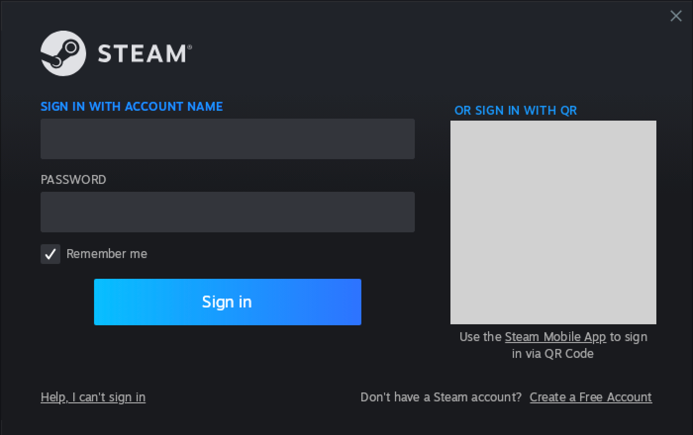

# Install guide: Surviving Mars: Relaunched

Getting **Surviving Mars: Relaunched** running on an Apple Silicon Mac, free: no CrossOver, and no other
game of this project needed first.

> **Status (2026-11-13).** The installer is new. Each of its steps is tested, and its step for Apple's
> D3DMetal has run for real on a scratch wrapper; a wrapper made from nothing by hand runs the game, and
> the game runs on the engine the installer builds. The installer as a whole has not yet taken a Mac from
> nothing to the game in one run. This note goes when it has.

## The quick way

One line in Terminal does the whole install. It makes the Wine wrapper, puts Apple's D3DMetal 3.0 into
its Wine, puts Steam for Windows in it, waits while you sign in and the game downloads, then builds the
game's app.

**You need:** an Apple Silicon Mac on macOS 14 or later (it has been run on macOS 27 only), a Steam
account that owns Surviving Mars: Relaunched, and about 20 GB of free disk space (the game is about
11 GB).

1. Open **Terminal** (in Applications → Utilities), paste this line and press Return:

   ```bash
   /bin/bash -c "$(curl --proto '=https' --tlsv1.2 -fsSL https://raw.githubusercontent.com/macgameport/1launcher/release/install.sh)" 1launcher-install 3215050
   ```

   The number at its end is the game's Steam app ID: it tells the installer which game is meant.

   macOS 26.4 and later can stop a pasted command with "Possible malware, paste blocked"; it is reported
   to let you paste it anyway. What the line runs is the script at that address, which you can read in a
   browser first.
2. The window works through seven steps and says what each one is doing. It can ask for three things on
   the way: to install Rosetta 2 (type `y`); in a box from Apple, to install Apple's Command Line Tools
   (press Install, then Agree); and, once, whether to fetch Apple's D3DMetal (type `y`; see
   [Apple's licence](#apples-licence-for-d3dmetal) below). Leave the window open; the Mac is kept awake
   while it runs.
3. When Steam's sign-in window appears, sign in with the account that owns the game, with "Remember me"
   ticked. Steam may ask for a code from your email or the Steam app. A small box headed
   "Steam - Fatal Error" can appear once or twice before the sign-in window and close again: that is
   Steam updating itself, and nothing in it needs a click.

   
4. In Steam, click **Library**, then **Surviving Mars: Relaunched**, then **Install**. The download is
   about 10 GB. When it finishes Steam shows a green Play button: do not press it. The installer's
   window sees the download finish and goes on by itself.

   

   (The pictures are from the Cities: Skylines II install; the windows are the same.)
5. The installer closes Steam and builds the app. It ends with `Done.`
6. Play: **Surviving Mars Relaunched** in Applications, or **14unch3r**, the window that lists every game
   set up on this Mac.

Good to know:

- **One Steam at a time.** If Steam for Windows is open in another wrapper on this Mac (another game of
  this project, or its Steam app), the installer stops before it starts its own and says which one: quit
  it, then open the installer again. Two Steams on one account push each other out, and the one pushed out
  skips its cloud upload. The installer can check this Mac only: it cannot see a Steam on another Mac, or
  the Steam of macOS. Close those yourself. The same holds every time you play.
- **Stopped part way?** Paste the line again. It carries on from the step it stopped at. Closing the
  window or pressing Control-C stops the installer only: Steam stays open. Pasting the line again on a
  finished install is also how to update.
- **If you already play this game somewhere else with mods from Paradox Mods.** Seen once, on
  2026-11-13: the first start in a new install warned that a mod could not be loaded, fetched the mod
  again by itself, and left it switched off, and through Steam Cloud it was then switched off on the
  other install too, until the Mod Manager was opened there. A save loaded meanwhile ran without its mod.
  So after a new install, open the game's Mod Manager once before you load a save, here and on your
  other Mac.
- **To look before it touches anything**, give it `--check`. With the pasted form the words after the
  closing quote are a name and then the arguments:
  `... install.sh)" 1launcher-install 3215050 release --check`
- **Asking for help?** Terminal's output can show your Mac's user name inside file paths. Look for it
  before pasting the output anywhere public.
- **Have a clone?** `bash surviving-mars-relaunched/scripts/install.sh` is the same installer, from your
  checkout. After `git pull`, run `bash surviving-mars-relaunched/scripts/setup.sh` again: the game's
  app runs a copy of the launcher, and setup renews it.

## What it downloads, and from whom

Nothing is re-hosted by this project: each file comes from its publisher to your Mac, and is held to a
fixed size and SHA-256 before anything is taken from it.

| What | Published by | File | Size |
|---|---|---|---|
| The wrapper, an empty app that Wine and the game live in | [Porting Kit](https://www.portingkit.com/), on GitHub | `Wineskin.app.tar.7z` | 53 MB |
| Wine 10, with Apple's D3DMetal 2.1 inside it | Porting Kit, on GitHub | `WS12WineSikarugir10.0_2_D3DMetal-v2.1.tar.7z` | 184 MB |
| Apple's D3DMetal 3.0, inside a build of Apple's Game Porting Toolkit | [Gcenx](https://github.com/Gcenx/game-porting-toolkit/releases/tag/Game-Porting-Toolkit-3.0-3), on GitHub | `game-porting-toolkit-3.0-3.tar.xz` | 239 MB |
| Steam for Windows | Valve | `SteamSetup.exe` | 2 MB |
| Rosetta 2 and the Command Line Tools, if missing | Apple | | |
| The game | Steam, to your own account | | about 10 GB |

From Gcenx's archive only six pieces are taken out, and nothing in it is run: the D3DMetal framework, one
library, and four DLLs. The framework and the library must carry Apple's own signature; the four DLLs,
which are not signed, must have the SHA-256 they had when this was tested. The game needs version 3.0:
on 2.1 a landscaping project turns the whole map black. Wine and Valve's installer run as they come:
macOS does not check programs fetched this way.

## Apple's licence for D3DMetal

D3DMetal is Apple's, a part of its Game Porting Toolkit. The installer asks before it fetches anything
that holds it, and stops if the answer is not `y`. Apple's licence for the toolkit (a text of 2023) is
linked from [Gcenx's release page](https://github.com/Gcenx/game-porting-toolkit/releases/tag/Game-Porting-Toolkit-3.0-3);
that address is Gcenx's, not Apple's. In plain words, and no more than the text says:

- It allows using the toolkit for developing, testing or evaluating games on a Mac. It does not name
  playing.
- It may be passed on only non-commercially.
- It ends on any breach, and you answer to Apple for your own use of it. By using the toolkit you agree
  to the licence; if you do not agree, do not fetch it.

This project passes on nothing of Apple's: no file of Apple's is in this repository or on its pages.

## Where things are

| What | Where |
|---|---|
| The wrapper: Wine, Steam, the game, your saves and mods | `~/Applications/SurvivingMars.app` |
| The app you start the game with | `~/Applications/Surviving Mars Relaunched.app` |
| The window that lists every game | `~/Applications/14unch3r.app` |
| The launcher the app runs, and its click helper | `~/Library/Application Support/1launcher/surviving-mars-relaunched/` (`launch-relaunched.sh`, `tools/`) |
| Logs of each start, and copies of saves the tools made | the same folder, `runs/` and `backup/` |
| The app's log | `~/Library/Logs/sm-relaunched-launcher.log` |

Saves travel by Steam Cloud: the launcher waits for Steam to pull them before the game starts and to
upload them after it exits.

## A Steam Cloud conflict

The launcher starts the game itself, so Steam never shows its "keep local or cloud?" question, and a
conflict would block every upload without a word. The launcher looks for one instead: it refuses to
start the game on a conflict, and says so after an exit whose upload was refused. Both times it names
the files.

To clear one, with the game and this wrapper's Steam closed:

1. Copy these two folders somewhere safe. Both are inside
   `~/Applications/SurvivingMars.app/Contents/SharedSupport/prefix/drive_c/`:
   `users/Wineskin/Saved Games/Surviving Mars Relaunched/<a long number>/`, your saves, and
   `Program Files (x86)/Steam/userdata/<a number>/3215050/`, Steam's record of them.
2. In the saves folder, delete the files the launcher named. In Steam's folder, delete
   `remotecache.vdf`.
3. Start the game. Steam pulls the cloud's copy of those files at sign-in. Saves that exist only on
   this Mac stay, and are uploaded at the next exit.

Measured on 2026-11-07 with one save deleted and the rest equal to the cloud's: Steam fetched all ten
cloud files in 22 seconds, with no conflict, and the deleted save came back byte for byte. What Steam
does with a file that differs from the cloud's when its record is gone has not been measured, which is
why step 2 deletes those files as well.

## Uninstall

The wrapper holds the game and its saves. Your saves are also in Steam Cloud, if the last exit uploaded
them.

```bash
rm -rf ~/Applications/SurvivingMars.app ~/Applications/"Surviving Mars Relaunched.app"
rm -rf ~/Library/Application\ Support/1launcher/surviving-mars-relaunched/launch-relaunched.sh ~/Library/Application\ Support/1launcher/surviving-mars-relaunched/tools
rm -f ~/Library/Logs/sm-relaunched-launcher.log
```

- `~/Library/Application Support/1launcher/surviving-mars-relaunched/backup/` holds copies of saves, and
  `runs/` holds logs. Look before you delete them.
- **14unch3r** and its preferences are shared with the other games of this project. Remove them only
  when no other game here uses them:

  ```bash
  rm -rf ~/Applications/14unch3r.app; rm -f ~/Library/Preferences/local.1launcher.window.plist
  ```
- If you gave the installer a folder of downloads (`L1_DOWNLOADS`), that folder is yours to remove.
- Rosetta 2 and Apple's Command Line Tools, if the installer added them, stay: they are Apple's, and
  other programs may use them.
